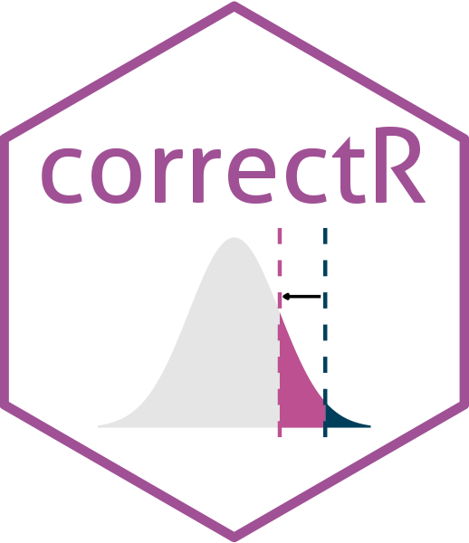

<p align="center">


</p>

<h1 align="center">

<em>correctR</em>: Corrected Test Statistics for Comparing Machine Learning Models on Correlated Samples
</h1>

<p align="center">

<a href="https://zenodo.org/badge/latestdoi/578642033"></a>
<a href="https://github.com/hendersontrent/correctR/blob/main/LICENSE.md"></a>
<a href="https://hendersontrent.github.io/correctR/"></a>
<a href="https://cran.r-project.org/package=correctR"></a>
<a href="https://cran.r-project.org/package=correctR"></a>
</p>

*correctR* is a lightweight R package that implements corrected test statistics for comparing the performance of two machine-learning models when the samples are not independent.
This happens whenever performance values (e.g., classification accuracy) come from data resampling, $k$-fold cross-validation, or repeated $k$-fold cross-validation.
These methods give several values per model, which is useful for estimating error and generalizability, but the values are correlated, so a standard $t$-test underestimates the variance and inflates the Type I error ([Dietterich, 1998](https://pubmed.ncbi.nlm.nih.gov/9744903/)).
*correctR* implements corrections for this problem proposed by [Nadeau and Bengio (2003)](https://doi.org/10.1023/A:1024068626366), including the repeated $k$-fold form presented by [Bouckaert and Frank (2004)](https://doi.org/10.1007/978-3-540-24775-3_3).
Currently, only comparisons of two models are supported.

📖 **Full documentation:** [hendersontrent.github.io/correctR](https://hendersontrent.github.io/correctR/), including the vignette and function reference.

## Installation

Install the stable version from CRAN:

``` r
install.packages("correctR")
```

Or install the development version from GitHub:

``` r
devtools::install_github("hendersontrent/correctR")
```

## Usage

| Function | Use when |
|----|----|
| `resampled_ttest()` | Performance values come from random subsampling (repeated train-test splits) |
| `kfold_ttest()` | Performance values come from $k$-fold cross-validation |
| `repkfold_ttest()` | Performance values come from repeated $k$-fold cross-validation |

Each function returns a `data.frame` with the $t$-statistic (`statistic`) and its $p$-value (`p.value`).
For example, to compare two models using accuracy values from 30 random train-test splits, each with 80 training and 20 test samples:

``` r
library(correctR)

set.seed(123)
x <- rnorm(30, mean = 0.6, sd = 0.1) # accuracy of model 1 on each resample
y <- rnorm(30, mean = 0.4, sd = 0.1) # accuracy of model 2 on each resample

resampled_ttest(x = x, y = y, n = 30, n1 = 80, n2 = 20)
```

      statistic    p.value
    1  2.407318 0.02265982

Tests are two-tailed by default; set `tailed = "one"` and `greater = "x"` (or `"y"`) for a directional hypothesis.
See the [vignette](https://hendersontrent.github.io/correctR/articles/correctR.html) for all three tests.

## References

The methods implemented in *correctR* are described in:

> C. Nadeau and Y. Bengio.
> [Inference for the Generalization Error](https://doi.org/10.1023/A:1024068626366).
> *Machine Learning* **52**, 239-281 (2003).

and, for the repeated $k$-fold correction:

> R. R. Bouckaert and E. Frank.
> [Evaluating the Replicability of Significance Tests for Comparing Learning Algorithms](https://doi.org/10.1007/978-3-540-24775-3_3).
> *Advances in Knowledge Discovery and Data Mining (PAKDD 2004)*, Lecture Notes in Computer Science **3056** (2004).

The software is archived on Zenodo: [10.5281/zenodo.7445136](https://doi.org/10.5281/zenodo.7445136).

## License

*correctR* is licensed under the [MIT License](LICENSE.md).
